# A channel strip, hosted in plugin-hostd

The console's channel strip as one Zynthian chain: omx-strip (omx-plugins, GPL-3.0), run by plugin-hostd. One
snapshot:

- `004-Channel strip (omx-strip).zss`: one audio chain from audio input 1, `Channel strip`, one processor:

  ```
  audio input 1 -> omx strip (input > filters > gate > EQ > comp) -> mixer
  ```

  Set for a voice: the high-pass at 100 Hz, the gate opening at -50 dB and closing by 30 dB, the EQ cutting 3 dB
  of mud at 300 Hz, adding 2 dB of presence at 3 kHz and a 1.5 dB high shelf at 10 kHz, and the compressor at
  -20 dB, 3:1, 10 ms attack, 150 ms release, 3 dB makeup. Every other control is at its default.

The processor is `PH/clap:/usr/lib/clap/omx-strip.clap#org.openmixer.strip`: the CLAP build of omx-strip, as
plugin-hostd's catalogue names it. Its controllers in the snapshot are the plugin's parameter numbers (`41` is the
compressor's threshold).

## What it needs

- OpenMixer on the Zynthian (`scripts/recipes/install_openmixer.sh`) and the omx-plugins package
  (`omx-plugins-clap`), which installs `/usr/lib/clap/omx-strip.clap`.
- The plugin qualified, as every plugin plugin-hostd runs under Zynthian's settings (`require_pins 1`): the
  qualification sync does it for a newly installed package.
- The snapshot in a bank: copy it into `/zynthian/zynthian-my-data/snapshots/001-OpenMixer examples/` (the install
  recipe of the guitar rack example, zynthian-sys#42, copies every `examples/*/NNN-*.zss` there once). Then
  Snapshots -> `001-OpenMixer examples` -> `004-Channel strip (omx-strip)`.

## The control groups, page by page

omx-strip has no curve or meter, so Zynthian shows it as controller pages: the list of pages on the left, the four
controls of the selected page on the knobs. These pictures are the snapshot loaded (480x320, the stock look), taken
with zynthian-ui's `tools/panel_screens.py`; every value shown was read back from plugin-hostd after the snapshot's
values were set.

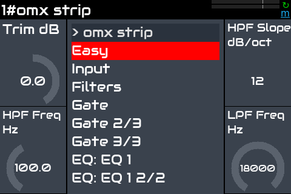

| Page | Controls | What the group does | |
|---|---|---|---|
| Easy | Trim, HPF Freq, HPF Slope, LPF Freq | The quick setup, the plugin's own Easy page: the input trim, the high-pass frequency and slope, the low-pass frequency. Here the high-pass at 100 Hz. | 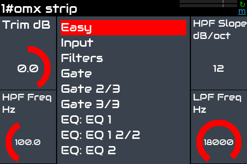 |
| Input | Input | The input stage on or off; its trim is on the Easy page. | |
| Filters | Filters, HPF, LPF, LPF Slope | The high-pass and low-pass filters: the block on, each filter on, the slopes (12 or 24 dB/oct). Here the high-pass is on at 100 Hz. | 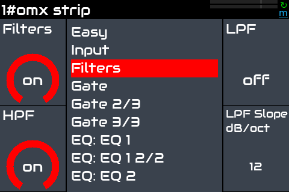 |
| Gate, Gate 2/3, Gate 3/3 | Gate, Threshold, Ratio, Range; Attack, Release, Knee Start, Knee End; Hold, Hysteresis | The noise gate: where it opens, how hard and how far it closes, how fast, its soft knee, how long it holds open and the gap between opening and closing. Here on, at -50 dB, closing by 30 dB. | 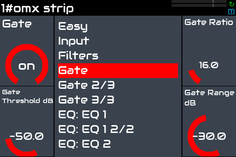 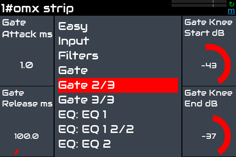 |
| EQ: EQ 1, EQ: EQ 1 2/2 | EQ, EQ Bands, Type, Freq; Gain, Q, on | The EQ on and how many bands it has (1 to 32, four at first), then band 1: its shape (Bell, Low Shelf, High Shelf, ...), frequency, gain, width and on. Band 1 is off here. | 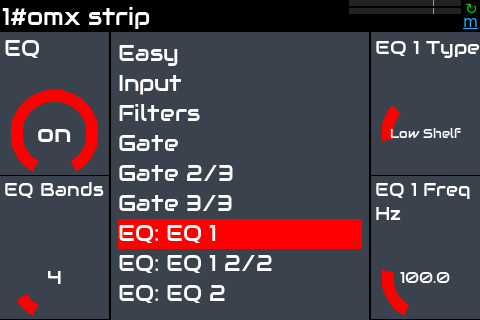 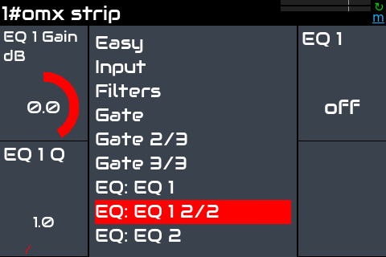 |
| EQ: EQ 2 .. EQ: EQ 4 (each with a 2/2) | Type, Freq, Gain, Q; on | Bands 2 to 4: here a Bell at 300 Hz, -3 dB, Q 1.2; a Bell at 3 kHz, +2 dB; a High Shelf at 10 kHz, +1.5 dB. A band past `EQ Bands` has no page. | 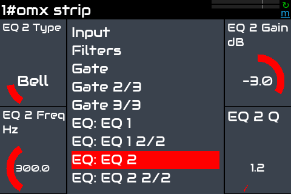 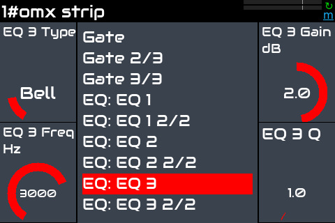 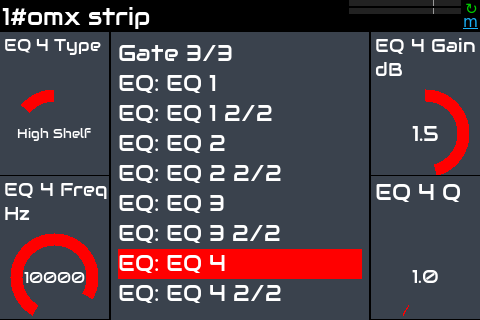 |
| Comp, Comp 2/3, Comp 3/3 | Comp, Threshold, Ratio, Knee; Attack, Release, Makeup, Kind; Mix, Detector Oversampling | The compressor: where and how hard it works, its knee, how fast, the gain it gives back, Compressor or Limiter, the dry/wet mix, the detector's oversampling. Here on, -20 dB, 3:1, 10 ms, 150 ms, +3 dB. | 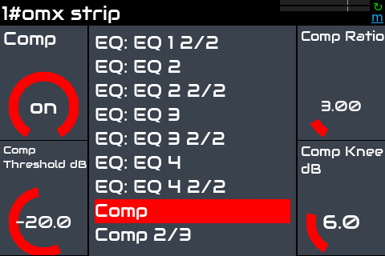 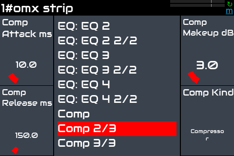 |
| Order | Order | The order the five stages run in: 0 is the console's own, input > filters > gate > EQ > comp; 1 to 119 every other order. | 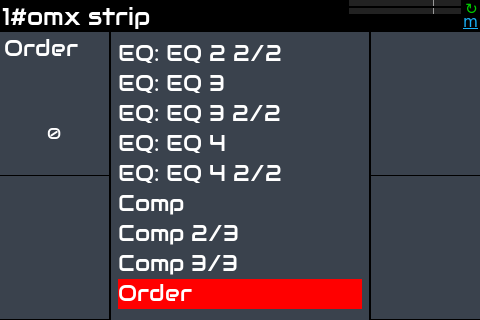 |

On a V5 (800x480) the list fills the left of the screen:

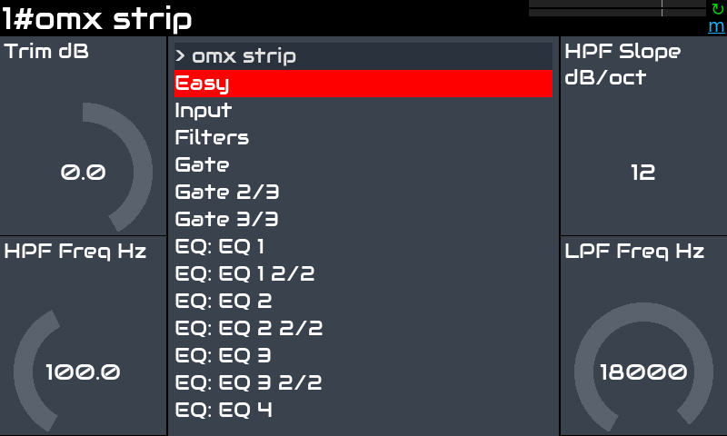

The pages of every omx plugin, how they are cut and named, and the plugins that show a curve, meters or a bar
group, are in zynthian-ui's `docs/openmixer-panels-on-zynthian.md`.

## How these pictures were taken

With zynthian-ui's lane/zynthian-panel-docs (the panel bound by the layout's `param`, `libomx-panel-render.so.1`),
omx-clap-host 0.36.0 (a CLAP parameter named by its contract symbol), omx-panel 0.17.3 (one Easy page, the plugin's
own) and omx-plugins 0.22.4, in a debian trixie container; the same run took 480x320 and 800x480, stock and vintage.
An older pair shows a second Easy page marked `+`, `Gate: Gate - Gate Knee End` and `Trim d B`.
